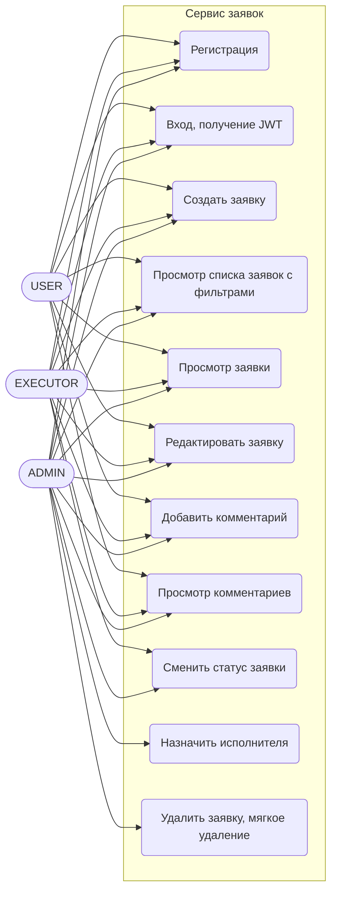
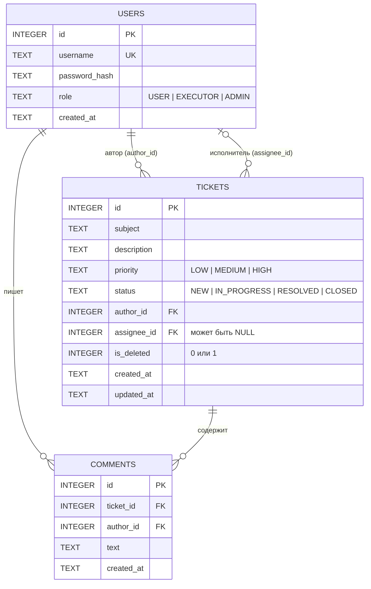
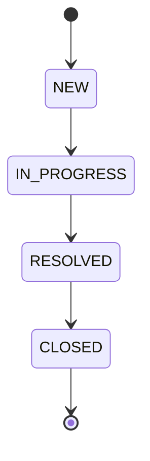

# Проектирование модуля «Сервис заявок»

Документ описывает проект программного модуля учёта заявок (Service Desk): варианты использования, модель данных, архитектуру, жизненный цикл заявки, права доступа и перечень эндпоинтов API.

## 1. Диаграмма вариантов использования



## 2. ER-диаграмма базы данных



Все таблицы приведены к третьей нормальной форме: каждое поле зависит только от первичного ключа своей таблицы, данные пользователей хранятся один раз в `users` и на них ссылаются по внешним ключам. Для фильтрации списка заявок созданы индексы по `status`, `priority` и `assignee_id`.

## 3. Архитектура модуля

Модуль разделён на слои, каждый вызывает только слой ниже:

```
HTTP-запрос
   │
   ▼
Контроллеры (app/api)            - разбор запроса, коды ответов, JSON
   │
   ▼
Сервисы (app/services)           - бизнес-логика, проверка прав и переходов статусов
   │
   ▼
Репозитории (app/repositories)   - SQL-запросы к SQLite
   │
   ▼
База данных (SQLite, миграции в migrations/)
```

Сервисы получают репозитории через конструктор, поэтому в модульных тестах репозитории заменяются заглушками (`unittest.mock`).

| Слой | Каталог | Ответственность |
|---|---|---|
| Контроллеры | `app/api/` | маршруты Flask, валидация формата тела запроса, проверка JWT |
| Сервисы | `app/services/` | правила предметной области |
| Репозитории | `app/repositories/` | доступ к таблицам `users`, `tickets`, `comments` |
| Безопасность | `app/security.py` | выдача и проверка JWT, хеширование паролей |
| Миграции | `migrations/`, `app/migrate.py` | создание схемы БД |

## 4. Жизненный цикл заявки



Разрешены только переходы вперёд по цепочке `NEW → IN_PROGRESS → RESOLVED → CLOSED`. Любые другие, например `CLOSED → NEW` или `NEW → RESOLVED`, запрещены, при попытке возвращается ошибка 409.

## 5. Матрица прав доступа

| Действие | Аноним | USER | EXECUTOR | ADMIN |
|---|---|---|---|---|
| Регистрация, вход | да | да | да | да |
| Создать заявку | нет | да | да | да |
| Список и просмотр заявок | нет | да | да | да |
| Редактировать заявку | нет | свою (автор) | назначенную на него | любую |
| Сменить статус | нет | нет | назначенной на него | любой |
| Назначить исполнителя | нет | нет | нет | да |
| Удалить заявку (is_deleted) | нет | нет | нет | да |
| Добавить / смотреть комментарии | нет | да | да | да |

Аутентификация: при входе выдаётся JWT (HS256), токен передаётся в заголовке `Authorization: Bearer <token>`.

## 6. Перечень эндпоинтов API

| Метод | Путь | Описание | Доступ |
|---|---|---|---|
| POST | `/auth/register` | регистрация пользователя | все |
| POST | `/auth/login` | получение JWT | все |
| GET | `/tickets` | список заявок, фильтры `status`, `priority`, `assignee_id`, страницы `page`, `page_size` | авторизованные |
| POST | `/tickets` | создание заявки | авторизованные |
| GET | `/tickets/{id}` | заявка по идентификатору | авторизованные |
| PUT | `/tickets/{id}` | редактирование заявки | автор, исполнитель, ADMIN |
| DELETE | `/tickets/{id}` | мягкое удаление | ADMIN |
| PATCH | `/tickets/{id}/status` | смена статуса | исполнитель, ADMIN |
| PATCH | `/tickets/{id}/assignee` | назначение исполнителя | ADMIN |
| GET | `/tickets/{id}/comments` | список комментариев | авторизованные |
| POST | `/tickets/{id}/comments` | добавление комментария | авторизованные |
| GET | `/docs` | Swagger UI | все |
| GET | `/openapi.json` | спецификация OpenAPI | все |

Формат ошибок: `{"error": "текст"}` с кодами 400 (неверные данные), 401 (нет или неверный токен), 403 (нет прав), 404 (не найдено), 409 (конфликт: недопустимый переход статуса, занятое имя пользователя).

## 7. Допущения

- Роль пользователя передаётся при регистрации (упрощение для учебного модуля).
- Приоритеты заявок: `LOW`, `MEDIUM`, `HIGH`.
- Мягко удалённая заявка не возвращается ни в списке, ни по идентификатору.
- Перечень эндпоинтов подготовлен для согласования с руководителем практики.
